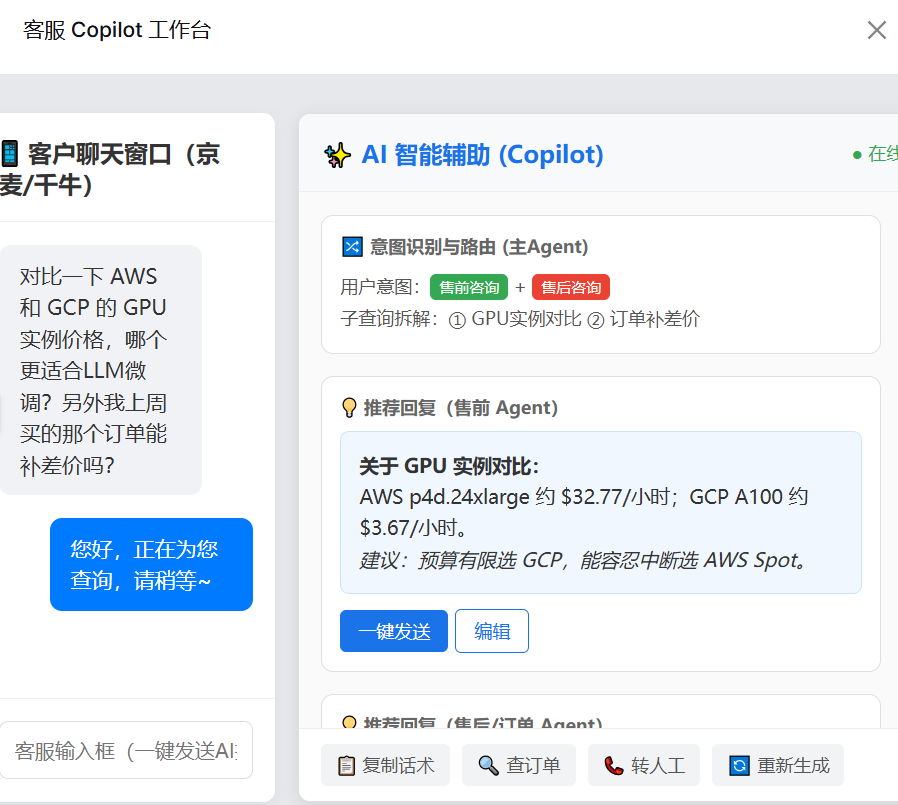

# kj-dianshang · 电商智能客服系统

基于 **BM25 快速通道 + BGE-M3 混合检索 RAG + 多 Agent 编排** 的电商智能客服一体化系统。
从通用问答系统（INTEGRATED_QA_SYSTEM）迁移至电商域：商品咨询、订单查询、售后政策三大业务场景。



## 核心能力

| 模块 | 技术方案 | 说明 |
| --- | --- | --- |
| FAQ 快速通道 | BM25（rank_bm25 + jieba） | 高频问题命中直接返回答案，不走 LLM |
| RAG 检索 | BGE-M3 稠密+稀疏混合检索 → bge-reranker-large 重排 | 父块/子块双粒度切分，WeightedRanker 混合打分 |
| 查询分类 | bert-base-chinese 微调（缺失时自动回退底座模型） | 通用知识 / 专业咨询二分类 |
| 多 Agent 编排 | 意图路由 + 售前/售后/订单子 Agent + 大额订单升级 Agent | 按平台阈值（淘宝 5000 / 京东 10000 / …）自动转人工 |
| 存储抽象层 | Store / Cache 抽象：local_mode 下降级 SQLite + 本地向量库 + 内存缓存 | 单机 Docker 开箱即用 |
| 服务层 | FastAPI + WebSocket + SSE 流式输出 | 原生 Web 客服工作台（static/index.html） |

## 快速开始（Docker，推荐）

前置条件：Docker / Docker Compose，一个 DeepSeek API Key（OpenAI 兼容接口）。

```bash
# 1. 配置 API Key
export DASHSCOPE_API_KEY=sk-your-deepseek-api-key

# 2. 构建并启动（首次启动自动下载模型，约 4-5GB，耐心等候）
docker compose up -d --build

# 3. 查看日志（等待模型下载完成、服务监听 18080）
docker compose logs -f app

# 4. 打开客服工作台
#    http://localhost:18080
```

### 灌库（构建向量索引）

镜像内已带种子数据 `data/ecom.db`（SQLite，FAQ/订单开箱可用）。如需用 `dataset/` 源数据重建：

```bash
docker compose exec app python ecom_data/ingest.py --limit 500   # 先小样本验证
docker compose exec app python ecom_data/ingest.py               # 全量灌入
```

### 常用命令

```bash
docker compose ps          # 查看状态
docker compose logs -f app # 跟踪日志
docker compose down        # 停止
docker compose up -d       # 再次启动（模型已缓存，秒起）
```

## 本地开发

```bash
# 1. Python 3.11+，建议先装 CPU 版 torch
pip install torch --index-url https://download.pytorch.org/whl/cpu
pip install -r requirements.txt

# 2. 下载模型（约 4-5GB；国内加 HF_ENDPOINT=https://hf-mirror.com）
python scripts/download_models.py

# 3. 配置（复制模板填入真实 Key，config.ini 已被 .gitignore 保护）
cp config.example.ini config.ini

# 4. 灌库 + 启动
python ecom_data/ingest.py --limit 500
python app.py                # 监听 0.0.0.0:18080
```

## 接口一览

| 接口 | 方法 | 说明 |
| --- | --- | --- |
| `/` | GET | 客服工作台页面（static/index.html） |
| `/api/query` | POST | 问答接口（SSE 流式返回） |
| `/api/stream` | WebSocket | WebSocket 流式对话 |
| `/api/create_session` | POST | 创建会话 |
| `/api/history/{session_id}` | GET / DELETE | 查询 / 删除会话历史 |
| `/health` | GET | 健康检查 |
| `/api/sources` | GET | 有效业务来源列表 |

## 目录结构

```
├── app.py                  # FastAPI 服务入口（端口 18080）
├── new_main.py             # 问答主系统：BM25 + RAG + 多 Agent 编排
├── base/                   # 配置 / 日志 / 存储 / 缓存抽象层
├── ecom_agent/             # 意图路由 + 售前/售后/订单/升级 Agent + 编排器
├── ecom_data/              # 电商数据灌库脚本（dataset/ → SQLite + 向量库）
├── mysql_qa/               # BM25 FAQ 快速通道（local_mode 下读 SQLite）
├── rag_qa/                 # RAG：向量库 / 本地降级向量库 / 查询分类 / 混合检索重排
├── static/                 # 客服工作台前端
├── tests/                  # E2E / 路由 / 升级 Agent 测试
├── scripts/
│   ├── download_models.py  # 模型下载（BGE-M3 / bge-reranker-large / bert-base-chinese）
│   └── entrypoint.sh       # Docker 入口（首启自动下载模型）
├── dataset/                # 电商域源数据（约 115MB，详见 dataset/README_数据清单.md）
├── data/ecom.db            # 种子 SQLite（FAQ / 订单 / 会话）
├── docs/                   # 改造方案、数据调研报告、产品形态演示
├── Dockerfile / docker-compose.yml
└── config.example.ini      # 配置模板（config.ini 不入库）
```

## 数据集说明

`dataset/` 为电商客服开源数据集汇总（详见 `dataset/README_数据清单.md`）：

- `01_商品库_products/` 商品信息（JSONL，约 7MB）
- `02_订单_orders/` 订单数据（JSONL）
- `03_售后政策_after_sales_policy/` 各平台售后政策文档 + 规则
- `04_FAQ问答对_faq/` FAQ 问答对 + EcomGPT/电信 FAQ 原始数据
- `05_客服对话_多轮_dialog/` 多轮客服对话（dianjin / full_ecom_chatbot）
- `06_意图情绪标注_intent_emotion/` 意图情绪标注数据（ChineseEcomQA 等）

## 配置说明

`config.ini`（仓库只提交模板 `config.example.ini`）：

- `[app] local_mode = true`：单机降级模式（SQLite + 本地向量库 + 内存缓存），**Docker 默认模式**
- `[llm]`：OpenAI 兼容接口，默认 DeepSeek；**API Key 用环境变量 `DASHSCOPE_API_KEY` 传入，不要写进配置文件**
- `[milvus]`：远程 Milvus 地址支持 `MILVUS_HOST` / `MILVUS_PORT` 等环境变量覆盖

## 安全说明

- 仓库不包含任何真实 API Key / 密码；真实密钥曾硬编码于 `base/config.py` 兜底值，**已清除并建议轮换该 Key**
- 大模型权重（约 9GB）不入库，由 `scripts/download_models.py` 按需拉取

## 技术栈

Python 3.11 · FastAPI · OpenAI SDK（DeepSeek）· pymilvus / milvus-model · BGE-M3 · bge-reranker-large · bert-base-chinese · rank_bm25 + jieba · Redis / MySQL（远程模式）· SQLite（本地降级）· Docker
